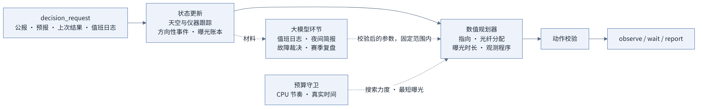
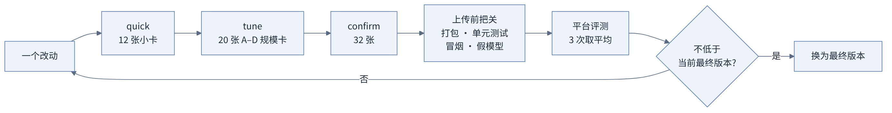

<div align="center">

# Agentic Observer · 巡天值班智能体

**每一次曝光交给数值规划，每一段文字交给大模型；每个改动先在没见过的卡上证明自己。**


[最终提交](agent/) · [设计说明](agent/README.md) · [本地实验环境](lab/README.md) · [比赛主页](https://create.gosim.org/survey26/)

</div>

GOSIM 2026 Agentic Observer Hackathon 参赛作品，队伍 cloudbrain，决赛（隐藏任务卡 E–H）第 6 名。
智能体在模拟的光纤光谱巡天里当值班天文学家：每一步决定望远镜指向哪里、每根光纤分给哪个目标、曝光多久、用哪个观测程序，
同时读公报和值班日志、判断仪器故障，并在 CPU 预算和真实时间上限之内跑完整个赛季。

## 成绩

| 决赛总分 | E | F | G | H |
|---:|---:|---:|---:|---:|
| **31,680** | 36,969 | 29,502 | 27,216 | 33,035 |

每张隐藏卡由主办方评测 3 次取平均。比赛期间各版本在正式赛 A–D 上的成绩见[验证与证据](#验证与证据)。

## 思路

我们对这道题有五个判断，后面所有设计都从这里来。

- **比的是没见过的卡。** 排名只看比赛结束后才运行的隐藏卡 E–H，公开卡 A–D 打得再高也不算数。
  所以不针对公开卡调参，每个改动都要在一批本地模拟的、和公开卡无关的卡上胜出才采纳。
- **只算最好的一次。** 同一目标多次曝光不累加，半截曝光如果以后还要重拍，就是纯浪费。
  所以规划不是"这一步收益最大"，而是给整个赛季的光纤时间定价，决定哪些目标现在一次拍完、哪些留到条件更好时。
- **决策交给数值，判断交给模型。** 一季几千到上万次决策，每次要在上万个（指向，时长）组合里挑，这是数值优化的活；
  而公报、值班日志里的自然语言，以及"这像不像故障"的判断，才是大模型擅长的。模型的答案先经代码校验，只在固定范围内生效。
- **时间是硬约束。** 每张卡 900 秒 CPU 预算，外加 30 分钟真实时间上限，到了就结束，剩下的赛季全部作废。
  预算要按剩余赛季分配，等模型回答的时间也要算进真实时间里。
- **稳定比峰值重要。** 决赛每张卡跑 3 次取平均。程序不能有崩溃的可能，同样输入应当得到同样的决策。

## 工作原理

**数值规划器做出每一个动作；大模型读文字、做判断，答案经代码校验后只能在固定范围内调整规划；任何一环失败，巡天照常进行。**



- **规划器**（`planner.py`）：每次决策对所有可见目标、20 种曝光时长计算收益，在约 30 个锚点周围各试几百个指向偏移，
  按评测引擎相同的几何把目标映射到光纤格子，选"总收益 − 时间价格 × 时长"最大的方案。时间价格来自赛季计划：
  剩余赛季能完成哪些目标、一个光纤秒值多少分。必观测目标按"以后来不及做的风险"加权，随赛季推进逐步加大。
- **跟踪器**（`tracker.py`）：在天气水平、仪器效率、是否有故障三个量上做贝叶斯滤波。天气同时影响完成度和观测程序档位，
  仪器效率只影响完成度，据此从自己的曝光结果里把两者分开，并区分地震、仪器故障和圆顶临时关闭。
- **大模型**：值班日志提取（`duty.py`）、夜间简报、故障裁决、带工具调用的赛季复盘（`supervisor.py` `advisor.py`），
  详见下面折叠的表格和 [`agent/README.md`](agent/README.md)。

一季下来最容易丢分的地方，和我们的防法：

| 风险 | 会发生什么 | 怎么防 |
|---|---|---|
| 过拟合公开卡 | 公榜高、隐藏卡低 | 84 张本地模拟卡分开发 / 调参 / 确认 / 封存四层；配对比较给出统计结论，不看单张卡 |
| 真实时间截断 | 评测引擎每步都要遍历全部已记分记录，越到赛季后段越慢；到 30 分钟上限，剩余赛季作废 | 真实时间守卫：测量引擎耗时并拟合其增长，预测装不下时先降搜索力度，再改为更少、更长的曝光 |
| CPU 超预算 | 900 秒用完，提前结束 | 按剩余赛季分配每次决策的 CPU，超出才分级降低搜索力度；力度只按固定档位变化，避免计时噪声改变决策 |
| 模型慢、限流、答非所问 | 等不到答案、卡住或做出错误动作 | 暂停—等待—继续，并设真实时间预算；同一时刻只发一个请求，被限流就退避重试；答案校验加固定范围；失败就退回规则 |
| 故障误报 | 每次误报 −150 | 故障后验概率持续偏高、且期望收益大于误报代价才上报；上报有代价时先问模型；限制付费误报次数 |
| 值班日志里的陷阱 | 被更正、取消或代号误导而错误报修 | 每条事实必须引用原文行号，代码独立校验时区、时间区间和版本；不合法就忽略 |
| 程序自身出错 | `agent_error` 结束整场 | 三层兜底：发出前校验动作；任何异常换成一次等待；模型环节可以整体关闭 |

<details>
<summary>四个大模型环节</summary>

| 环节 | 模型读什么 | 模型决定什么 | 生效范围 |
|---|---|---|---|
| 值班日志 | 公开的 `observation_request.reason` 原文、站点时区 | 已确认的硬件故障时段、非故障的校准 / 维护时段、已取消或更正的事件 | 每条事实须引用原文行号并通过代码校验，转成一次性报修、非故障等待或曝光上限 |
| 夜间简报 | 预报、公报、近几晚天空水平、必观测目标余量 | 今晚避开哪些方位、曝光是否保守、必观测目标加紧还是暂缓 | 只能避开公告点名的方位；其余各有固定档位 |
| 故障裁决 | 最近 24 次曝光的天气水平和仪器效率估计、公报、误报代价 | fault / not_fault / unsure | 上报有代价时才问；可以暂缓一次上报；规则风控仍然生效 |
| 赛季复盘 | 模型自己调用 4 个工具查询：进度、近期天空、必观测目标、预报 | 规划器多大程度上"把目标留到能一次拍完" | 在规则默认值上下 0.10 以内 |

模型服务按环境变量自动识别（OpenAI 兼容或 Anthropic 协议），配置多家时自动切换。原生工具调用不可用时，改用纯文本形式的工具协议。

</details>

## 开发方法

隐藏卡看不到，公开卡又只有输入没有天气，本地无法打分。所以我们先搭了一个本地闭环实验环境（[`lab/`](lab/README.md)），
再让每个改动走同一圈：



- **造卡。** 用官方公开的模拟器按种子生成带天气、事件和限时请求的本地卡：A–D 的真实目录配模拟天气，
  加上站点、季节、赛季长度、目标数、光纤布局、计分零点都随机的变体卡，模拟隐藏卡可能的样子。共 84 张，`test` 组 16 张封存到定版前才跑。
- **比较。** 同一批卡上配对比较两个版本，给出 BETTER / WORSE / NO DIFFERENCE / UNCLEAR 的结论；固定搜索力度时决策可复现，单卡噪声约 ±1–2%。
- **把关。** 上传前自动检查：打包后用平台自己的代码读回、扫描密钥；几何与官方引擎逐项一致；四张短卡正常结束；
  再用一个本地假模型服务模拟 9 种情况（正常、无原生工具、文本工具、答案在推理内容里、
  限流、20 秒才回答、乱码、报错、超时），要求能用的答案确实生效、不能用的不影响运行。
- **分工。** 云端 AI 助手负责搭实验环境、写候选版本和把关工具；本地 16 核机器上的 AI 助手按一份写明规则、纪律和待办的任务说明跑大规模实验；
  平台评测只做最终确认。方向和取舍由我们决定。

## 验证与证据

**平台正式赛（A–D 均分）**

| 版本 | 内容 | 成绩 |
|---|---|---:|
| v1 | 规则核心 | 31,148.84 |
| v1（关模型） | 同一版本，评测时不提供模型 | 31,134.00 |
| v1 + 大模型环节 | Kimi，3 次评测平均 | 31,056.04 |
| v2 + 大模型环节 | 空闲时段的圆顶探测与重新定价、独立的指向偏差估计、更紧的光纤边缘余量、地形遮挡按时段记录 | 32,271.83 |
| v3 – v8 | 真实时间守卫、按实测重做的模型调用、故障恢复、值班日志理解（见 [`agent/PROVENANCE.md`](agent/PROVENANCE.md)） | 决赛 31,680（隐藏卡） |

**真实时间守卫**（本地，B 型卡；不压上限时同样设置分别为 −16,185 和 −22,310）

| 场景 | 守卫关 | 守卫开 |
|---|---|---|
| 40 夜，上限压到 380 秒（需要约 530 秒） | 被截断，−25,451 | 跑完，−16,969 |
| 40 夜，上限压到 150 秒（需要约 210 秒） | 被截断，−31,109 | 跑完，−21,899 |
| 完整赛季 183 夜，上限 1,800 秒 | 赛季剩 10% 时被截断，36,829，必观测缺 46 个 | 1,373 秒跑完，41,600，必观测缺 4 个 |

40 夜卡拍不完全部必观测目标，所以总分为负，看差值即可。完整赛季那一行不是严格对照：守卫关的那次运行时机器上还在跑别的实验。
守卫不动作时不改变任何决策：加入提速和守卫后，PT、A8、B8、C8、D8 五张卡的分数与 v2 核心逐位相同（固定搜索力度）。

**大模型调用实测**（Kimi）：一次回答 15–30 秒，而模拟里的一整晚只要几秒真实时间；中转约只允许 2 个并发。
所以咨询改为在关键时点"暂停—等待—继续"，不能边跑边等。

## 试过但没有用的

- **加大搜索量。** B 型卡上搜索力度从 0.22 提到 1.0，得分不变（5,760 对 5,760）；锚点搜索范围放大 4 倍，平均占用的光纤数基本不变（约 21.7–21.8 根）。
  瓶颈在目标的空间分布，不在搜索。
- **专门为恶劣天气做处理。** 同一星表、同一种子，标准与恶劣天气各跑 16 夜：得分比 0.64 / 0.84，可用容量比 0.63 / 0.83，
  光纤时间的有效比例基本不变。现有机制在坏天气下没有额外损失。
- **靠大模型提分。** 在公开卡上，模型环节对分数的影响在运行噪声以内（见上表 v1 三行）。我们把它定位为处理文字信息和意外情况的能力：
  规则已经覆盖的情况，模型只在固定范围内微调；规则无法处理的自由文本（值班日志），才由模型提取事实。

## 局限

- 规划是逐步贪心加赛季级定价，不是全局最优。在目标稀疏的卡上，后半季空光纤和被取代的曝光仍然占相当比例。
- 值班日志环节只提取故障、校准、维护和更正，不解析所有天气和地形语义。
- 本地卡的天气和事件是按官方模拟器规则生成的，不是官方卡的真实天气；本地分数用于比较版本，不预测平台成绩。

## 快速开始

需要 Python 3.10+ 和 numpy，以及主办方的官方示例包（本地裁判程序和任务卡，不在本仓库中）。

```bash
git clone https://github.com/codezzzsleep/gosim26-agentic-observer.git
cd gosim26-agentic-observer/agent
pip install --target .deps -r requirements.txt
cp .env.example .env            # 可选：填一组模型服务的密钥；不填则纯规则运行
PYTHONPATH=.deps python3 <官方示例包>/runner/run_local.py --inherit-env \
    --card <官方示例包>/local-cards/L1 --agent "python3 -u agent.py" --agent-cwd .
```

核对最终提交：`cd agent && sha256sum -c SHA256SUMS`（与平台提交包逐字节一致，`.env.example` 是开源时补的）。

本地实验环境：把官方仓库放到 `lab/hackathon-survey26/`、官方任务卡的公开输入解压到 `lab/cards/official/`，然后运行 `bash lab/setup.sh`，详见 [`lab/README.md`](lab/README.md)。

## 项目结构

```
agent/                 最终提交（平台修订 93d8609f）
  agent.py             协议主循环、故障上报、CPU 节奏、真实时间守卫
  planner.py           规划器与赛季计划
  tracker.py           天空与仪器状态的贝叶斯跟踪
  hazards.py           公报里的方向性事件
  pointing.py          指向偏差估计
  state.py             目标目录与可重放的曝光账本
  skymath.py           天球几何
  duty.py              值班日志的语义提取与校验
  supervisor.py        大模型环节的接线与时间预算
  advisor.py           提示词、工具定义、答案校验
  llm.py               模型客户端（纯标准库）
lab/                   本地闭环实验环境（默认测试上面的 agent/）
  setup.sh             环境、造卡、自检
  tools/               造卡、跑分、配对比较、健康检查、上传前把关、假模型、单元测试、光纤时间分析
  cards/SETS.json      84 张本地卡的配方（卡本身由工具生成，不在仓库里）
  cards/CHECKSUMS.json 造出的卡的校验和
assets/                README 里的流程图（PNG）及其 Mermaid 源文件
```

## 文档

[设计说明](agent/README.md) · [最终版改动记录](agent/PROVENANCE.md) · [实验环境](lab/README.md) · [第三方材料](NOTICE.md)

## 许可与引用

本队编写的代码和文档采用 [MIT](LICENSE) 许可。

主办方提供的比赛数据、任务卡、评测程序与示例项目按 [CC BY-NC 4.0](https://creativecommons.org/licenses/by-nc/4.0/) 提供（署名、非商业），
不在本仓库中，详见 [`NOTICE.md`](NOTICE.md)。使用本仓库中依赖这些材料的部分时，请引用：

> GOSIM 2026 Agentic Observer Hackathon (https://create.gosim.org/survey26/)

```bibtex
@article{,
  title   = {},
  author  = {},
  journal = {},
  year    = {2026},
  url     = {}
}
```

---

<details>
<summary>English summary</summary>

Entry of team cloudbrain to the GOSIM 2026 Agentic Observer Hackathon; 6th place in the final round (hidden cards E–H, total 31,680).

**Idea.** Only unseen cards count, so every change had to win on a set of locally simulated cards unrelated to the public ones.
Only the best exposure of a target counts, so the planner prices fibre time over the whole season instead of maximising each step.
Decisions are numerical; judgement over text is the LLM's: a numpy planner makes every exposure decision, while an LLM extracts
facts from the duty log (validated against line citations, time zones and intervals), writes a nightly briefing, gives a fault
verdict and runs a tool-calling season review — each confined to fixed ranges and falling back to the rules on any failure.
Time is a hard constraint: besides CPU pacing, a real-time guard measures how the engine slows down as the season's ledger grows
and switches to fewer, longer exposures before the 30-minute cap would cut the season short.

**Method.** A local closed-loop lab (`lab/`): 84 simulated cards in four tiers (quick / tune / confirm / sealed test), paired
comparisons with statistical verdicts, and a pre-upload gate (package check, unit tests, smoke cards, a mock model service in nine modes).

**Contents.** `agent/` is the final submission, byte-identical to the platform package (`agent/SHA256SUMS`; `.env.example` added).
Code and documentation by the team: MIT. The organizers' data, task cards, evaluation programs and example projects
([CC BY-NC 4.0](https://creativecommons.org/licenses/by-nc/4.0/)) are not included; cite GOSIM 2026 Agentic Observer Hackathon
(https://create.gosim.org/survey26/), or the organizers' paper on the benchmark once it is published.

</details>
